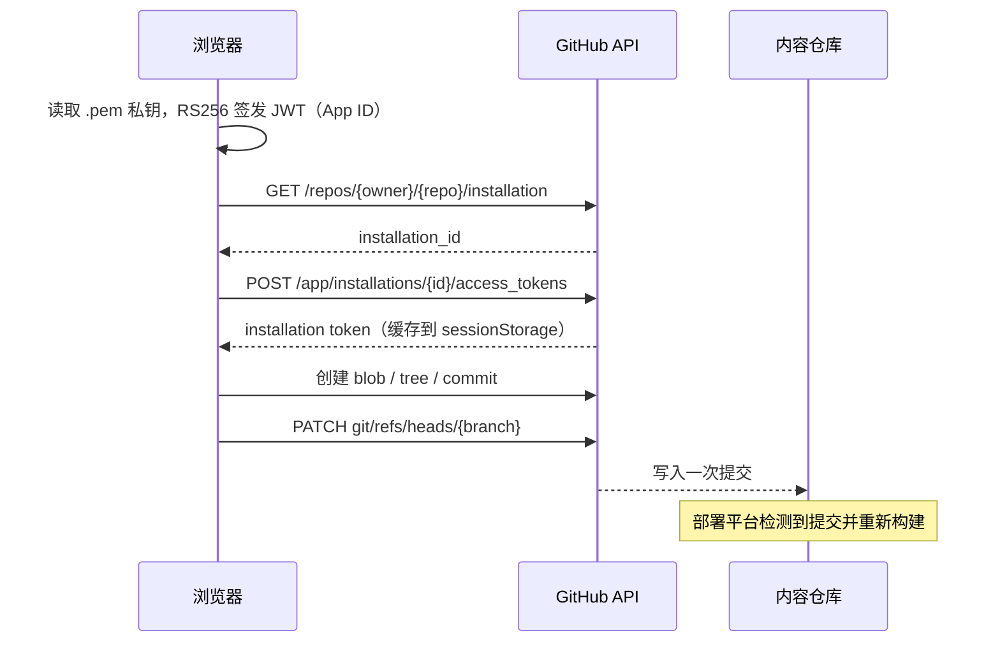

# Yuvex Blog

Yuvex 的个人博客站点，基于 Next.js 16 App Router。项目没有数据库，也没有业务后端：**GitHub 仓库就是内容库与管理后台**。在网页端导入 GitHub App 私钥后，可直接在浏览器里写文章、改站点配置、维护项目/分享/图库等数据，保存时会以一次 Git 提交写回仓库，再由部署平台重新构建发布。

> 模板来源：[YYsuni/2025-blog-public](https://github.com/YYsuni/2025-blog-public)（MIT），原始图文部署引导：<https://www.yysuni.com/blog/readme>
>
> 当前仓库：[IFILOSEIT-ALL/copy-blog](https://github.com/IFILOSEIT-ALL/copy-blog)

---

## 目录

1. [项目概览](#1-项目概览)
2. [快速开始](#2-快速开始)
3. [环境变量](#3-环境变量)
4. [GitHub App 配置](#4-github-app-配置)
5. [项目结构](#5-项目结构)
6. [内容与数据模型](#6-内容与数据模型)
7. [页面与路由](#7-页面与路由)
8. [在线编辑指南](#8-在线编辑指南)
9. [认证与写入链路](#9-认证与写入链路)
10. [部署](#10-部署)
11. [常见问题](#11-常见问题)
12. [开发提示](#12-开发提示)
13. [许可证与致谢](#13-许可证与致谢)

---

## 1. 项目概览

### 功能

| 模块 | 说明 |
| --- | --- |
| 首页 | 卡片式个人主页，内置问候语、插画、时钟、日历、音乐、社交按钮、最新文章、待办清单、写文章入口、导航卡片；支持拖拽、缩放、显隐和排序 |
| 博客 | 按日 / 周 / 月 / 年 / 分类分组展示；分类管理与排序；批量删除；本地已读标记 |
| 文章详情 | Markdown 渲染、目录（TOC）、封面/摘要侧栏、点赞、代码高亮与一键复制 |
| 写作台 | Markdown 编辑器、预览、封面（本地或外链）、正文图集、标签、摘要、日期、分类、隐藏文章、发布 / 更新 / 删除 |
| 站点配置 | 站点标题与描述、用户名、Favicon、头像、社交按钮、首页插画、背景图、主题色、备案信息、节日效果等 |
| 内容页 | 我的项目、优秀博客、推荐分享、图库、交互录（关于）、碎语、SVG 图标库、时钟/计时器、图片压缩工具箱 |
| 订阅 | 自动生成 `/rss.xml` 与 `/sitemap.xml` |
| 认证 | 浏览器内 GitHub App JWT 签名，私钥可选加密缓存；保存即提交仓库 |

### 技术栈

- **框架**：Next.js 16（App Router、Turbopack、React Compiler）、React 19、TypeScript 5
- **样式**：Tailwind CSS 4、CSS 变量主题、`tailwind-merge`、`clsx`
- **状态**：Zustand 5（站点配置、写作草稿、布局编辑、认证、阅读记录）、SWR
- **内容渲染**：`marked` + `shiki`（代码高亮）、`html-react-parser`
- **动效与 UI**：`motion`、`lucide-react`、`sonner`
- **GitHub 写入**：`jsrsasign`（RS256 JWT）+ GitHub REST API
- **部署**：Vercel，或 Cloudflare Workers（`@opennextjs/cloudflare` + `wrangler`）

---

## 2. 快速开始

### 环境要求

- Node.js ≥ 20
- pnpm（仓库使用 `pnpm-lock.yaml`）

### 安装与启动

```bash
pnpm install
pnpm dev
```

开发地址：<http://localhost:2025>（端口由 `package.json` 指定）。

### 可用脚本

| 命令 | 说明 |
| --- | --- |
| `pnpm dev` | 启动开发服务器（Turbopack，端口 2025） |
| `pnpm build` | 生产构建 |
| `pnpm start` | 启动生产服务 |
| `pnpm svg` | 监听 `src/svgs/` 并重新生成 `src/svgs/index.ts` |
| `pnpm build:cf` | 构建 Cloudflare Workers 版本（OpenNext） |
| `pnpm preview` | 本地预览 Cloudflare 构建产物 |
| `pnpm deploy` | 部署到 Cloudflare Workers |
| `pnpm cf-typegen` | 生成 Cloudflare 环境类型 |

> 只想先上线、不本地开发也可以：把仓库导入 Vercel，配置好环境变量直接部署，再按第 4 节创建 GitHub App 即可。

---

## 3. 环境变量

变量读取位置：[src/consts.ts](src/consts.ts)、[src/app/sitemap.ts](src/app/sitemap.ts)、[src/app/rss.xml/route.ts](src/app/rss.xml/route.ts)。

| 变量 | 必填 | 默认值 | 说明 |
| --- | --- | --- | --- |
| `NEXT_PUBLIC_GITHUB_OWNER` | 生产必填 | `IFILOSEIT-ALL` | 内容仓库所属用户/组织 |
| `NEXT_PUBLIC_GITHUB_REPO` | 生产必填 | `copy-blog` | 内容仓库名 |
| `NEXT_PUBLIC_GITHUB_BRANCH` | 否 | `main` | 内容提交分支 |
| `NEXT_PUBLIC_GITHUB_APP_ID` | 是 | `-` | GitHub App 的 App ID |
| `NEXT_PUBLIC_GITHUB_ENCRYPT_KEY` | 否 | `wudishiduomejimo` | PEM 缓存加密口令（见下方安全说明） |
| `BLOG_SLUG_KEY` | 否 | 空 | 点赞服务中给 slug 加前缀，避免与他人重名 |
| `NEXT_PUBLIC_SITE_URL` | 建议 | `https://www.yysuni.com` | RSS 中使用的站点地址，**务必改成自己的域名** |
| `SITE_URL` | 否 | `VERCEL_URL` / `http://localhost:3000` | sitemap 使用的站点地址 |

注意事项：

- `NEXT_PUBLIC_*` 会在构建时写入前端产物，修改后必须重新部署才生效。
- 这些变量只包含仓库坐标和 App ID，**私钥不要放进任何环境变量**。
- `NEXT_PUBLIC_GITHUB_ENCRYPT_KEY` 同样是公开的。它只用于给 sessionStorage 中的 PEM 做 AES-GCM 混淆，不能当作真正的安全边界。
- 若同一套代码部署多个站点，可分别配置 owner/repo 与 `BLOG_SLUG_KEY`。

---

## 4. GitHub App 配置

网页端的写入能力依赖 GitHub App，而不是个人 Access Token。

1. 打开 GitHub → **Settings → Developer settings → GitHub Apps → New GitHub App**。
2. `GitHub App name`、`Homepage URL` 任意填写；**取消 Webhook**（本项目不需要）。
3. 仓库权限只需一项：**Repository permissions → Contents → Read and write**（Metadata 会自动带上只读）。
4. 创建后记录 **App ID**。
5. 在 App 页面生成 **Private key**，下载 `.pem` 文件并妥善保存（文件丢失可重新生成）。
6. 进入 **Install App**，只勾选当前博客仓库完成安装。
7. 在部署平台设置环境变量（至少 `OWNER`、`REPO`、`APP_ID`），然后重新部署一次。
8. 打开站点，进入编辑状态后按提示导入 `.pem` 私钥即可开始使用。

> 私钥只留在浏览器内存中，用于本地签名 JWT。启用「缓存 PEM」后会用 AES-GCM 加密后写入 `sessionStorage`，关闭标签页即失效；但加密口令是公开的，请自行评估风险。私钥一旦泄露，应立即在 GitHub 上删除并重新生成。

---

## 5. 项目结构

```text
copy-blog/
├─ public/
│  ├─ blogs/                     # 文章、索引、分类
│  │  ├─ index.json              # 文章列表（前台读取）
│  │  ├─ categories.json         # 分类及顺序
│  │  └─ <slug>/
│  │     ├─ index.md             # 正文 Markdown
│  │     ├─ config.json          # 文章元信息
│  │     └─ <hash>.<ext>         # 文章内图片（按 SHA-256 命名）
│  ├─ images/                    # 头像、插画、图库、分享/博主 Logo 等
│  ├─ music/                     # 背景音乐
│  ├─ favicon.png
│  └─ manifest.json
├─ scripts/
│  └─ gen-svgs-index.js          # SVG 索引生成/监听
├─ src/
│  ├─ app/
│  │  ├─ (home)/                 # 首页卡片、站点配置面板、首页状态
│  │  ├─ blog/                   # 博客列表、详情页、分类与批量操作
│  │  ├─ write/                  # 写作台、编辑页、发布/删除服务
│  │  ├─ about/                  # 交互录
│  │  ├─ projects/               # 我的项目
│  │  ├─ bloggers/               # 优秀博客
│  │  ├─ share/                  # 推荐分享
│  │  ├─ pictures/               # 图库
│  │  ├─ snippets/               # 碎语
│  │  ├─ svgs/                   # SVG 图标库
│  │  ├─ clock/                  # 秒表/计时器
│  │  ├─ image-toolbox/          # 图片压缩工具
│  │  ├─ rss.xml/route.ts        # RSS
│  │  ├─ sitemap.ts              # sitemap
│  │  └─ layout.tsx              # 根布局与主题变量
│  ├─ components/                # 通用组件（卡片、预览、侧栏、音乐、点赞等）
│  ├─ config/
│  │  ├─ site-content.json       # 站点内容配置（可在线编辑）
│  │  ├─ card-styles.json        # 首页卡片布局（可在线编辑）
│  │  └─ card-styles-default.json # 布局重置基准
│  ├─ hooks/                     # 认证、尺寸、阅读记录、Markdown 渲染等
│  ├─ layout/                    # 页面布局、背景动效
│  ├─ lib/                       # GitHub 客户端、认证、AES、索引、渲染
│  ├─ svgs/                      # SVG 源文件与自动生成的 index.ts
│  ├─ styles/                    # 全局样式与文章样式
│  └─ consts.ts                  # 常量与 GitHub 配置
├─ next.config.ts
├─ open-next.config.ts
└─ wrangler.toml
```

---

## 6. 内容与数据模型

### 6.1 文章目录

每篇文章位于 `public/blogs/<slug>/`：

```text
public/blogs/ani-reze-arc/
├─ index.md
├─ config.json
└─ 6fdd11aa5410d5a9.webp
```

`config.json` 字段：

```json
{
  "title": "电锯人蕾塞篇",
  "tags": ["动漫", "电锯人", "影评"],
  "date": "2025-12-16T08:00",
  "summary": "一句话摘要",
  "cover": "https://example.com/cover.webp",
  "hidden": false,
  "category": "随笔"
}
```

- `date` 建议使用 `YYYY-MM-DD` 或 `YYYY-MM-DDTHH:mm`。
- `hidden: true` 时文章只对已认证用户展示（仍可通过直链访问）。
- `cover` 可以是外链，也可以是仓库内 `/blogs/<slug>/<hash>.<ext>` 路径。
- `category` 需配合 `siteContent.enableCategories` 使用。

### 6.2 文章索引与分类

`public/blogs/index.json` 是列表页的数据源，按 `date` 倒序保存：

```json
[
  {
    "slug": "ani-reze-arc",
    "title": "电锯人蕾塞篇",
    "tags": ["动漫"],
    "date": "2025-12-16T08:00",
    "summary": "一句话摘要",
    "cover": "https://example.com/cover.webp",
    "hidden": false,
    "category": "随笔"
  }
]
```

`public/blogs/categories.json` 保存分类及展示顺序：

```json
{ "categories": ["时记", "随笔"] }
```

发布文章时会同时更新 `index.md`、`config.json`、`index.json`；删除文章会递归删除整个 `public/blogs/<slug>/` 目录并更新索引。

### 6.3 站点配置

`src/config/site-content.json` 由首页配置面板读写，主要字段：

| 字段 | 说明 |
| --- | --- |
| `meta` | 标题、描述、用户名 |
| `theme` | 品牌色、主色、辅色、背景、边框、卡片、文章底色 |
| `backgroundColors` | 首页模糊气泡背景配色 |
| `artImages` / `currentArtImageId` | 首页插画列表与当前展示项 |
| `backgroundImages` / `currentBackgroundImageId` | 全站背景图 |
| `socialButtons` | 社交按钮（类型、值、标签、顺序） |
| `clockShowSeconds` | 时钟是否显示秒 |
| `summaryInContent` | 摘要显示在正文内还是右侧栏 |
| `isCachePem` | 是否加密缓存私钥 |
| `hideEditButton` | 隐藏各页面「编辑」按钮，改用快捷键进入编辑 |
| `enableCategories` | 启用文章分类 |
| `enableChristmas` | 开启圣诞背景与装饰 |
| `beian` | 备案文案与链接 |

`src/config/card-styles.json` 控制首页卡片：`width`、`height`、`order`（出现顺序）、`offsetX` / `offsetY`（相对屏幕中心的偏移）、`enabled`（是否显示）。「重置」会使用 `card-styles-default.json`。

### 6.4 列表类内容

以下页面直接读写各自的 `list.json`，保存时提交对应文件及新增图片：

| 页面 | 数据文件 |
| --- | --- |
| 我的项目 | `src/app/projects/list.json` |
| 优秀博客 | `src/app/bloggers/list.json` |
| 推荐分享 | `src/app/share/list.json` |
| 图库 | `src/app/pictures/list.json` |
| 碎语 | `src/app/snippets/list.json` |
| 交互录 | `src/app/about/list.json` |

背景音乐列表在 `src/app/music/list.ts`，需要手动维护。

### 6.5 待办清单

首页待办卡片的数据保存在浏览器 `localStorage`（键 `yuvex-home-todos`），不会提交到仓库，也不需要 GitHub 认证。每个浏览器/设备各自维护一份清单，清除站点数据会同时清空待办。

### 6.6 图片约定

- 文章图片：`public/blogs/<slug>/<sha256>.<ext>`，发布时按文件哈希去重，Markdown 中的 `local-image:<id>` 占位符会被替换为实际路径。
- 站点图片：头像 `public/images/avatar.png`、Favicon `public/favicon.png`。
- 插画 `/images/art/`、图库 `/images/pictures/`、分享 Logo `/images/share/`、博主头像 `/images/blogger/`、背景图 `/images/background/`、社交按钮图 `/images/social-buttons/`。
- 建议上传前压缩，宽度不超过 1200px。

---

## 7. 页面与路由

| 路由 | 页面 | 说明 |
| --- | --- | --- |
| `/` | 首页 | 卡片式布局、背景动效、站点配置入口 |
| `/blog` | 博客列表 | 日/周/月/年/分类分组、编辑、批量删除 |
| `/blog/[id]` | 文章详情 | 目录、封面、摘要、点赞、代码高亮 |
| `/write` | 写作台 | 新建文章 |
| `/write/[slug]` | 编辑文章 | 编辑模式下不可修改 slug |
| `/projects` | 我的项目 | 项目卡片增删改 |
| `/bloggers` | 优秀博客 | 博主收录与星级 |
| `/share` | 推荐分享 | 工具/网站推荐与星级 |
| `/about` | 交互录 | Markdown 关于页 |
| `/pictures` | 图库 | 随机布局图片墙 |
| `/snippets` | 碎语 | 随机展示一句话 |
| `/svgs` | SVG 图标库 | 搜索并复制导入语句 |
| `/clock` | 时钟 | 秒表与倒计时 |
| `/image-toolbox` | 图片工具箱 | 浏览器端图片压缩 |
| `/rss.xml` | RSS | 构建时根据 `index.json` 生成 |
| `/sitemap.xml` | 站点地图 | 构建时根据 `index.json` 生成 |

导航卡片（`src/components/nav-card.tsx`）默认提供：近期文章、我的项目、交互录、推荐分享、优秀博客。新增一级页面时，可在该文件的 `list` 中补充入口。

---

## 8. 在线编辑指南

所有编辑都要求先导入 GitHub App 私钥（`.pem`）。首次点击保存时若未认证，页面会弹出文件选择框。

### 8.1 首页与站点配置

- 首页按 **Ctrl/Cmd + L** 或 **Ctrl/Cmd + ,** 打开配置面板；也可点击「写文章」旁的小圆点按钮。
- 面板分三页：
  - **网站设置**：Favicon/头像上传、站点标题/描述/用户名、备案、社交按钮、插画、背景图、时钟/摘要/编辑按钮/分类/圣诞等开关。
  - **色彩配置**：主题色预设与自定义颜色。
  - **首页布局**：修改卡片宽高、顺序、偏移、显隐，或进入「主页拖拽布局」直接拖动卡片、拖右下角缩放。
- 「预览」只影响当前浏览器，不提交仓库；「保存」才会提交 `site-content.json` 与 `card-styles.json` 及相关图片。

首页「待办清单」卡片可直接在卡片内添加、勾选完成、双击文字编辑、删除单条或清除已完成；长列表在卡片内部滚动。待办数据只保存在当前浏览器，不会产生 Git 提交；卡片的位置、尺寸、显示顺序和开关仍通过「首页布局」调整。

### 8.2 写文章

1. 首页点击「写文章」或访问 `/write`。
2. 在编辑器写 Markdown，右侧配置封面、标签、日期、摘要、分类、是否隐藏。
3. 图片管理：先在「图片」区域添加图片，再把图片拖入正文；发布时会自动上传并替换占位符。
4. 右上角可预览。发布后提交 `index.md`、`config.json`、`index.json` 和文章图片。
5. 编辑已有文章访问 `/write/<slug>`；编辑模式不允许改 slug。删除会移除整个文章目录及索引记录。

### 8.3 文章列表管理

- 进入 `/blog` 后点击「编辑」，或按 **Ctrl/Cmd + ,**。
- 可勾选单篇、按分组全选、批量删除；可管理分类名称、顺序并给文章重新归类；保存时统一提交。
- 若站点配置开启了「隐藏编辑按钮」，页面上不会显示「编辑」，快捷键仍然可用。

### 8.4 其他页面

项目、博主、分享、图库、碎语、交互录的编辑方式一致：进入编辑态 → 增删改 → 保存；保存会把对应的 `list.json` 和新增图片写入仓库。

### 8.5 快捷键

| 快捷键 | 作用 |
| --- | --- |
| `Ctrl/Cmd + ,` | 进入/退出编辑（博客列表、项目、图库、关于等页面） |
| `Ctrl/Cmd + L` 或 `Ctrl/Cmd + ,` | 打开首页站点配置面板 |

> 移动端会隐藏大部分编辑按钮与部分卡片，编辑建议在桌面端进行。

---

## 9. 认证与写入链路



要点：

- JWT 使用 `iat = now - 60s`、`exp = now + 8min`，由 `jsrsasign` 在浏览器内签名，私钥不会发送到任何自建服务。
- 一次保存会把多个文件合并为**一次提交**（Git Data API：blob → tree → commit → 更新 ref），避免多次触发部署。
- Installation Token 缓存在 `sessionStorage`（键 `github_token`）；PEM 仅在开启缓存时以 AES-GCM 加密存入 `p_info`。
- 返回 `401` 会清除本地认证状态；返回 `422` 通常表示提交过快，页面提示稍后再试。
- 保存成功后页面数据会立即更新，但**线上其他访客要等部署完成并刷新**。

---

## 10. 部署

### 10.1 Vercel

1. 新建 Project → 导入仓库。
2. 配置第 3 节的环境变量（至少 `NEXT_PUBLIC_GITHUB_OWNER`、`NEXT_PUBLIC_GITHUB_REPO`、`NEXT_PUBLIC_GITHUB_APP_ID`，以及 `NEXT_PUBLIC_SITE_URL`）。
3. Deploy。Vercel 会监听仓库提交自动重新部署，因此网页端保存内容后会自动触发重建。

### 10.2 Cloudflare Workers

```bash
pnpm build:cf
pnpm preview   # 本地预览
pnpm deploy    # 部署
```

- 部署前把 `wrangler.toml` 中的 `name = "2025-blog-public"` 改成自己的 Worker 名称。
- 环境变量需要在构建环境中提供（`NEXT_PUBLIC_*` 在构建时固化）。
- Worker 不会因为 GitHub 提交自动重建，需要在 Cloudflare 控制台连接 Git 构建，或保存内容后手动重新部署。

### 10.3 域名与订阅

- sitemap 优先读取 `SITE_URL`，否则使用 `VERCEL_URL`，本地回退 `http://localhost:3000`。
- RSS 读取 `NEXT_PUBLIC_SITE_URL`，其默认值是模板作者的域名，部署前请改成自己的域名。
- `/rss.xml` 与 `/sitemap.xml` 都是构建时静态生成，内容更新后需重新部署。

---

## 11. 常见问题

**保存成功，但线上页面没变化？**
保存只是提交到 GitHub。请到仓库确认提交已产生，等待部署平台构建完成后再刷新；Vercel 一般会自动触发，Cloudflare 需自行接好 CI 或手动部署。

**提示「需要先设置私钥」或 401？**
确认导入的是当前 GitHub App 的 `.pem`，App 已安装到目标仓库，且 `APP_ID`、`OWNER`、`REPO` 正确；环境变量修改后需要重新部署。

**提示「操作太快了，请操作慢一点」（422）？**
GitHub API 对高频写入有限制，等待片刻后重试即可。

**编辑按钮不见了？**
`site-content.json` 中 `hideEditButton` 为 `true` 时按钮会隐藏，使用 **Ctrl/Cmd + ,** 进入编辑。

**文章隐藏后还能访问？**
`hidden` 只影响列表展示，直链仍可访问；如需彻底私有，请删除文章或改为不公开仓库。

**私钥缓存安全吗？**
默认只存在内存。开启「缓存 PEM」后会用公开口令加密存入 `sessionStorage`，属于便利性方案，不构成强安全保障。怀疑泄露时请立即在 GitHub 删除该私钥并重新生成。

**可以修改已发布文章的 slug 吗？**
不可以。编辑模式会校验 slug 不变；如需换地址，请新建文章并删除旧文章。

**图片怎么管理？**
推荐先压缩（宽度 ≤ 1200px），在写作台图片区添加后拖入正文，发布时自动上传；文章图片按内容哈希去重。

**分类不显示？**
需要先在站点配置中开启「启用文章分类」，再在博客列表编辑态维护分类。

**本地改了 `src/config/*.json` 但线上没变？**
本地修改只在当前构建生效；线上需提交并重新部署。通过网页配置面板保存会自动提交。

---

## 12. 开发提示

- `next.config.ts` 设置了 `typescript.ignoreBuildErrors = true`，构建不会因类型错误中断；建议提交前手动执行 `pnpm exec tsc --noEmit`。
- `reactCompiler` 已开启；`reactStrictMode` 关闭；开发指示器关闭。
- SVG 通过 `@svgr/webpack` 作为 React 组件导入，`pnpm svg` 可监听并更新 `src/svgs/index.ts`。
- Markdown 渲染在 [src/lib/markdown-renderer.ts](src/lib/markdown-renderer.ts)：`marked` 解析、标题生成 TOC、`shiki` 懒加载（Cloudflare Workers 环境加载失败时自动降级为纯文本）。
- 首页卡片定位基于屏幕中心 + `offsetX/offsetY`；新增卡片需同时补充 `card-styles-default.json`、`CARD_LABELS` 与首页渲染。
- 点赞使用外部服务 `https://blog-liker.yysuni1001.workers.dev/api/like`，可用 `BLOG_SLUG_KEY` 给自己的文章加前缀；如需独立统计可替换 [src/components/like-button.tsx](src/components/like-button.tsx) 中的 `ENDPOINT`。
- 所有内容写入集中在 `src/app/*/services/push-*.ts`，认证在 [src/lib/auth.ts](src/lib/auth.ts)，GitHub 请求封装在 [src/lib/github-client.ts](src/lib/github-client.ts)。
- 修改内容结构时请同步检查 `src/app/blog/types.ts`、`src/lib/blog-index.ts` 与 RSS/sitemap 的字段使用。

---

## 13. 许可证与致谢

- 本项目基于 [YYsuni/2025-blog-public](https://github.com/YYsuni/2025-blog-public)，遵循 MIT License，原始版权归 YYsuni 所有，详见 [LICENSE](LICENSE)。
- 原始部署与使用引导：<https://www.yysuni.com/blog/readme>
- 站点内容（文章、图片、项目与分享数据）版权归 Yuvex 所有。
